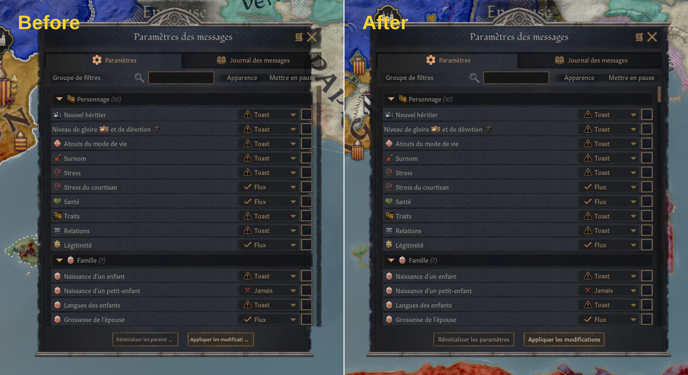
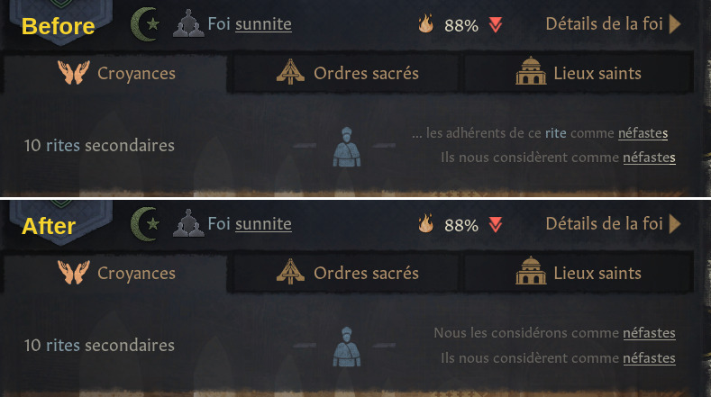
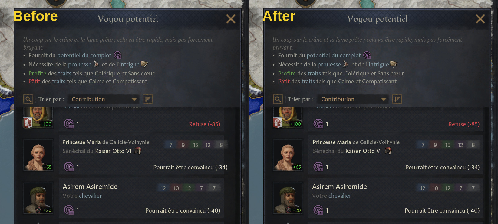
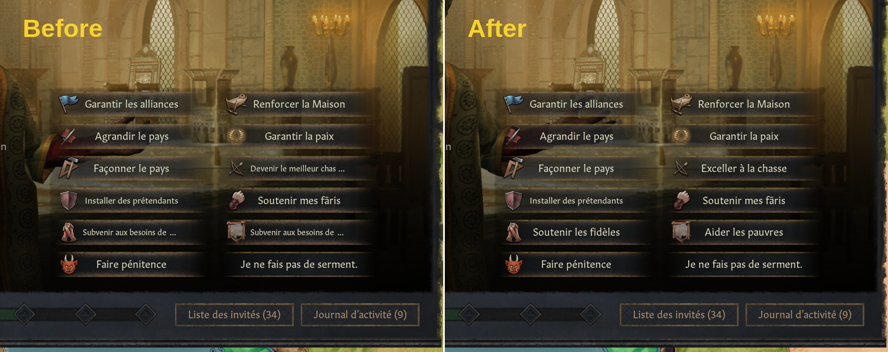
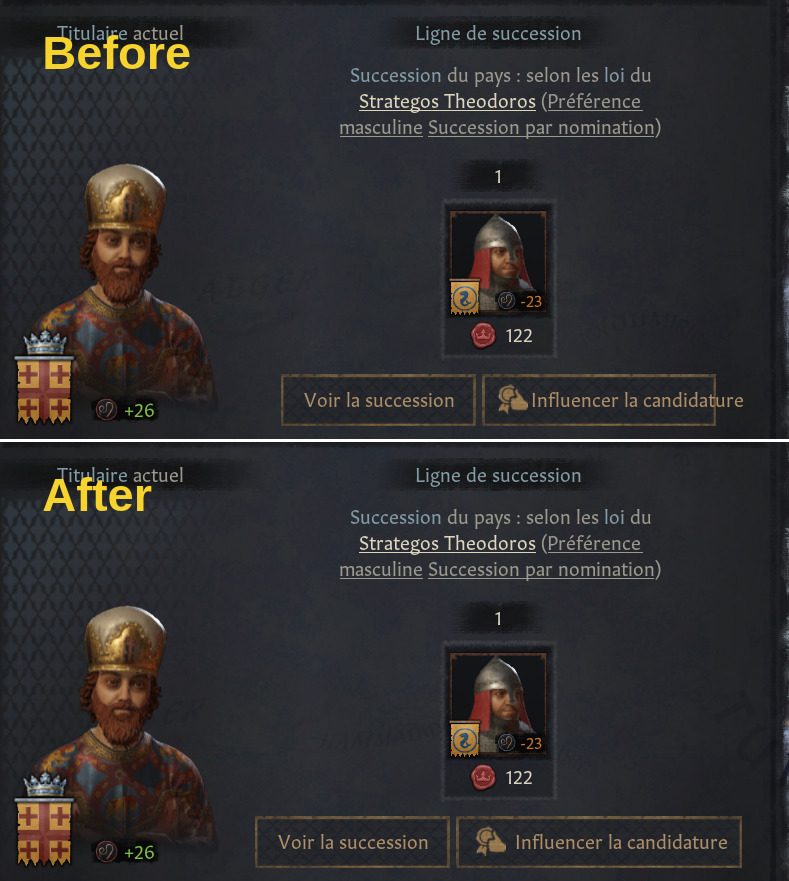
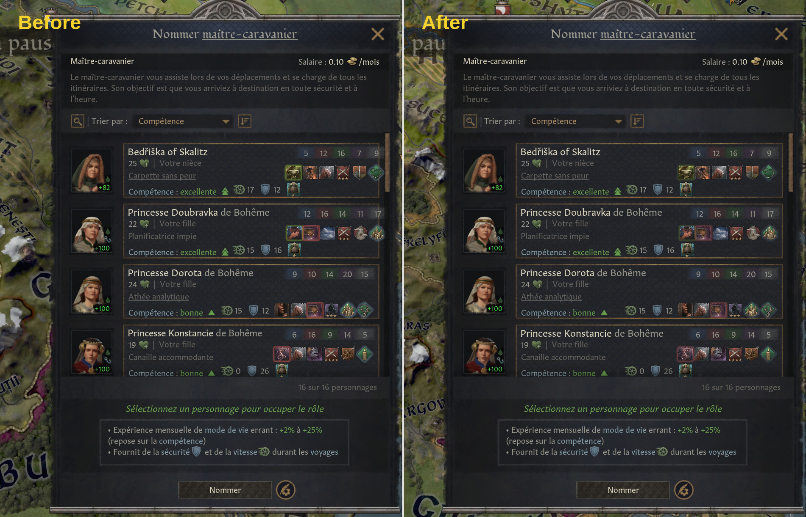

# Interface et traduction françaises corrigées

Ce mod s'adresse avant tout aux joueurs utilisant la version française de Crusader Kings III. Il corrige diverses erreurs et incohérences de localisation, ainsi que quelques problèmes d'affichage dans l'interface.

Lorsque c'est possible, les corrections sont appliquées aux textes plutôt qu'aux éléments d'interface, afin de conserver une compatibilité maximale avec les autres mods.

Le détail des corrections pour être trouvé dans *steam_description_FR.txt*

